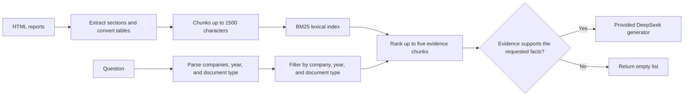

# FTEC5660 Homework 4

## Running the homework

Install the packages in `requirements.txt`, set `DEEPSEEK_API_KEY` in a local `.env`, then run:

```bash
python3 hw4.py --data-folder public_test
```

The runner writes `results.csv`. The `.env`, virtual environment, result file, and ablation outputs are ignored by Git.

## Homework 4 solution



`chunk_document` reads the company and report metadata from the document headings, converts each table row into text that keeps its row label, column header, value, and caption, then makes overlapping chunks no longer than 1,500 characters. `build_index` creates a BM25 index over those chunks without embeddings. `parse_query` identifies company names, fiscal years, and document types using the names found while chunking plus general name patterns. `retrieve` filters documents by those fields, selects a report that covers the requested year, and interleaves results by company for comparisons. It returns an empty list for companies or years absent from the corpus and for questions whose key terms lack supporting evidence. The provided generator handles the final answer.

### Ablation study

The table reports the public-set measurements from `ablation.py`. “Kept / rejected” shows the share of answerable questions that received chunks and the share of unanswerable questions that received no chunks.

| Variant | Added component | Task 1.1 tables | Task 1.2 chunks | Task 2.1 valid | Task 2.2 parse | Recall@5 | Kept / rejected | Task 4 accuracy |
|---|---|---:|---:|---:|---:|---:|---:|---:|
| B0 | Tutorial baseline | 0.0% | 0.0% | 100.0% | 0.0% | 4.3% | 100.0% / 0.0% | 26.7% |
| V1 | Table-to-text conversion | 100.0% | 0.0% | 100.0% | 0.0% | 4.3% | 100.0% / 0.0% | 25.0% |
| V2 | Section-aware chunking with metadata | 100.0% | 100.0% | 100.0% | 0.0% | 32.6% | 100.0% / 0.0% | 45.0% |
| V3 | Query parsing and metadata filters | 100.0% | 100.0% | 100.0% | 100.0% | 89.1% | 100.0% / 71.4% | 91.7% |
| V4 | Normalized BM25 tokens and query expansion | 100.0% | 100.0% | 100.0% | 100.0% | 100.0% | 100.0% / 71.4% | 100.0% |
| V5 | Per-company retrieval for comparisons | 100.0% | 100.0% | 100.0% | 100.0% | 100.0% | 100.0% / 71.4% | 100.0% |
| V6 | Evidence threshold for abstention | 100.0% | 100.0% | 100.0% | 100.0% | 100.0% | 100.0% / 100.0% | 100.0% |

Table conversion raised the table-cell score to 100%; the retrieval score stayed low until the document text was chunked with its section structure. Query parsing and metadata filters raised recall from 32.6% to 89.1% by separating similar company names and fiscal years. BM25 token normalization and query expansion raised recall to 100%. Per-company retrieval produced no additional score change on this public set; it remains useful for comparisons because each company receives a separate retrieval slot. The evidence threshold rejected all unanswerable questions while keeping all answerable questions.

The V3 misses were concentrated in comparisons where globally ranked chunks did not carry the needed fact for both companies, and in FY2023 questions where the answer appears in the FY2024 report. Query expansion and year-aware filtering found those passages in V4. V5 per-company retrieval produced no additional public-set gain. The final public run produced 60 rows in `results.csv` with no incorrect answers or retrieval misses. The ablation outputs and `results.csv` are generated locally and remain untracked.

### Reflection

The Task 6 reflection is included as a standalone PDF: [FTEC5660 Homework 4 Reflection](FTEC5660_HW4_Reflection.pdf). The assignment permits AI-generated submissions.
